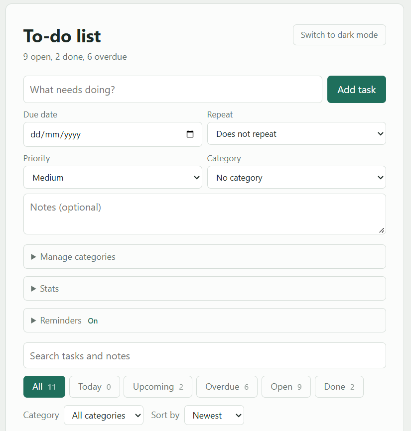
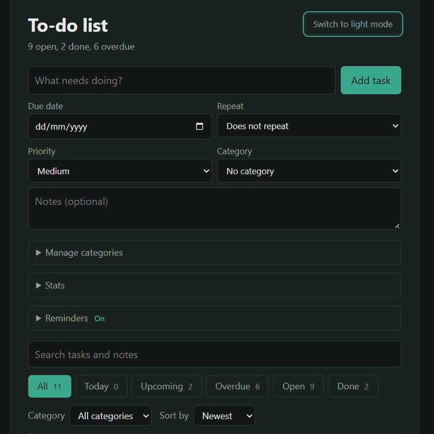
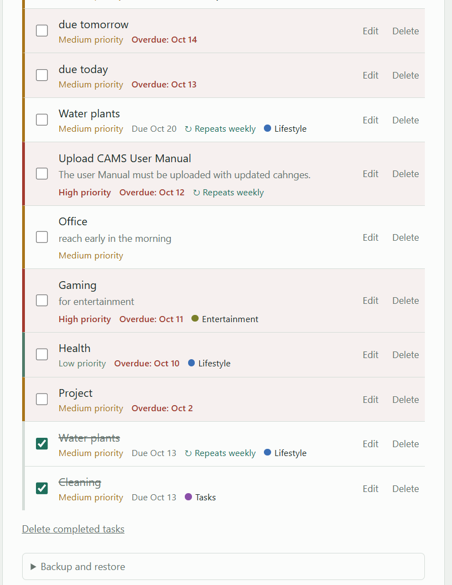
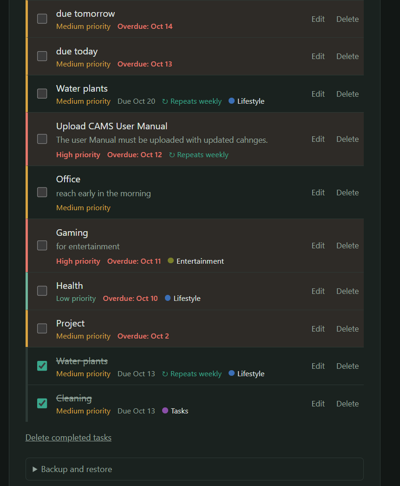

# To-do App

A simple to-do list web app built with HTML, CSS, JavaScript, PHP and MySQL, running locally on XAMPP.

## Screenshots

| Light mode | Dark mode |
|---|---|
|  |  |
|  |  |

## Features

- Add, edit, complete and delete tasks, with notes, due dates and priorities
- Categories with colours
- Filters (All, Open, Done, Overdue), search and sorting
- Drag-and-drop ordering ("My order")
- Dark mode
- Due-date reminders (browser notifications while the page is open)
- Recurring tasks (daily, weekly, monthly)
- Today and Upcoming views with task counts
- Stats panel
- Undo after deleting
- Backup and restore (JSON) and CSV export

## Setup

1. Install XAMPP and start Apache and MySQL.
2. Copy this folder to C:\xampp\htdocs\todo-app
3. Open http://localhost/phpmyadmin and create a database named todo_app (collation utf8mb4_unicode_ci).
4. Select todo_app, open the Import tab and import database.sql.
5. Open http://localhost/todo-app

## Database connection

The defaults are in db.php (user root, empty password, which are the XAMPP defaults). Change them there if your setup is different.

## License

MIT. See the LICENSE file.
